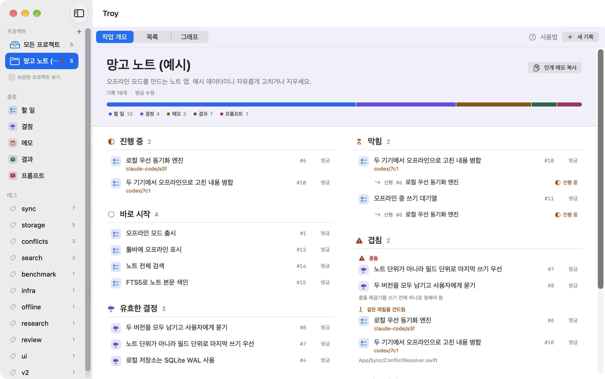
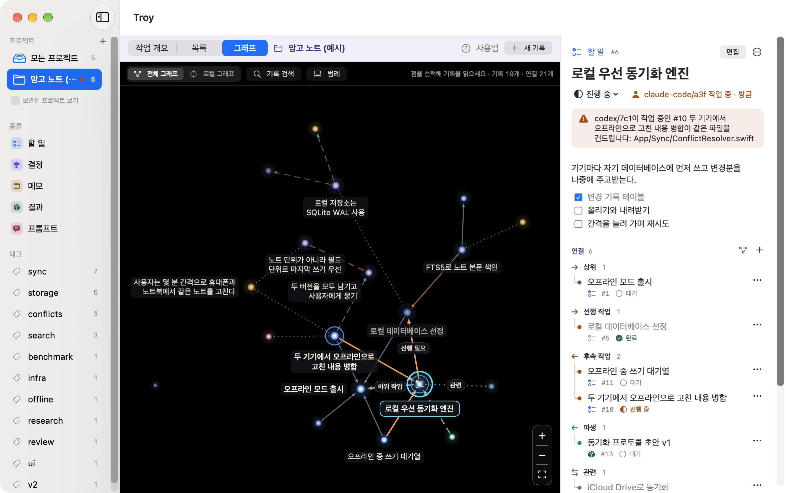
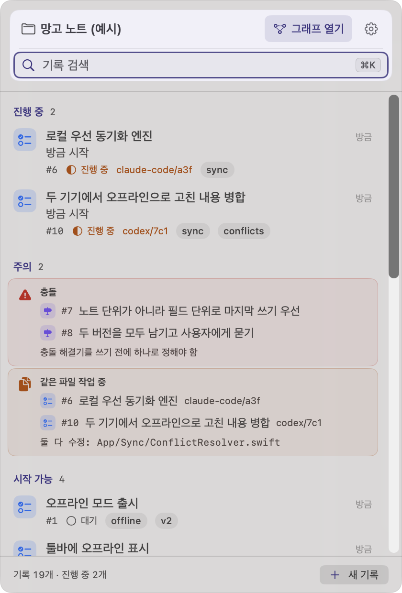
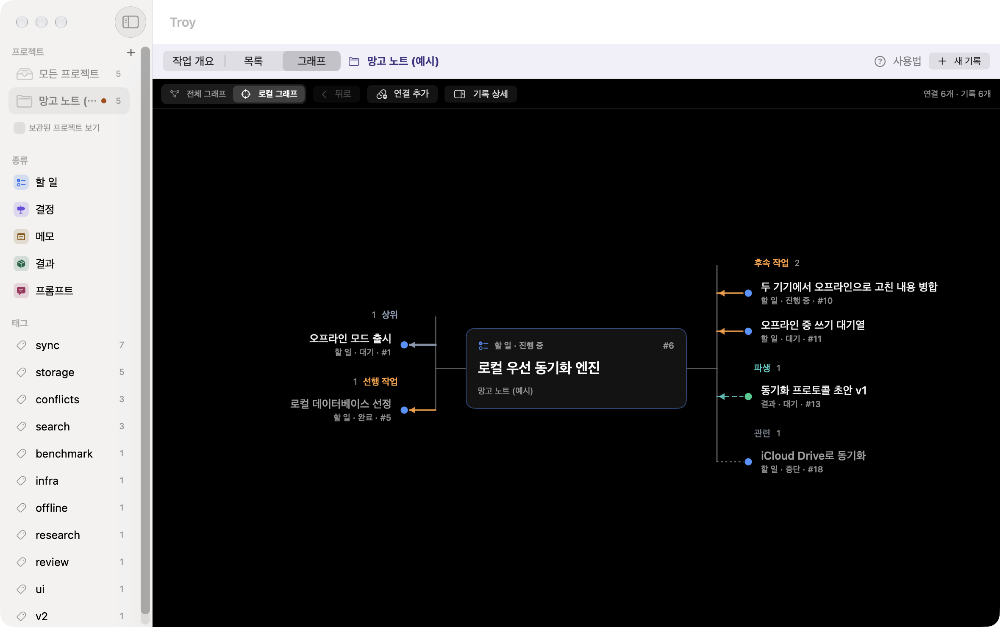

# Troy

**AI 코딩 에이전트를 위한 프로젝트 기억 장치. 내 Mac에서만 돕니다.** 에이전트가 할 일·결정·발견한 사실을 로컬 MCP 서버로 저장하고 서로 연결해 그래프로 만듭니다. 다음 세션이나 옆에서 함께 일하는 다른 에이전트는 처음부터 다시 파악하지 않고 그 상태를 읽어 옵니다. 같은 그래프를 메뉴바 앱으로 볼 수 있습니다.

[English](README.md) · [사용 가이드(PDF)](docs/Troy-Guide-ko.pdf)



- **로컬.** `~/Library/Application Support/Troy`의 SQLite 파일 하나가 전부입니다. 계정도, 서버도, 네트워크 포트도 없습니다.
- **네이티브.** Swift로 만든 메뉴바 앱과 `troy` 실행 파일 하나입니다. Electron도 웹뷰도 없고, 따로 깔아야 할 런타임이나 외부 라이브러리도 없습니다.
- **목록이 아니라 그래프.** 기록 하나가 여러 기록의 하위 항목이면서, 다른 기록에 의존하고, 어떤 기록을 대체하고, 또 다른 기록과 충돌할 수 있습니다. 연결은 에이전트가 저장할 때 만듭니다.
- **에이전트 여럿을 전제로.** 작업을 시작하면 점유가 기록됩니다. 두 세션이 같은 파일을 건드리거나 앞선 결정과 어긋나는 결정을 저장하면 서로 알게 됩니다.
- **읽는 비용이 낮게.** 기록 ID는 작은 숫자이고, 프로젝트 개요는 제목만 담으며, 본문은 필요할 때만 가져옵니다.

## 동작 방식

```
Claude Code ──┐
Codex ────────┼── troy mcp (클라이언트마다 프로세스 하나, stdio) ──┐
Cursor ───────┘                                                   ├── troy.db (SQLite, WAL)
                                                  Troy.app ───────┘
```

AI 클라이언트는 각자 `troy mcp` 프로세스를 띄웁니다. 앱도 같은 파일을 읽는 프로세스 하나일 뿐이며, 무엇이든 바뀌면 화면을 갱신합니다. 앱을 꺼 두어도 에이전트는 계속 쓸 수 있습니다.

## 설치

macOS 14 이상, Swift 6.2 이상(Xcode 26)이 필요합니다. 지금까지는 macOS 27에서만 빌드하고 실행해 봤습니다. 이전 버전에서의 동작 제보를 환영합니다.

```bash
git clone https://github.com/sjk0503/troy.git && cd troy
make install
```

앱을 빌드해 이 Mac용으로 서명한 뒤 `/Applications/Troy.app`에 복사하고, 명령줄 도구를 `~/.local/bin/troy`에 연결합니다. Spotlight나 `open -a Troy`로 실행하면 메뉴바에 아이콘이 나타납니다.

업데이트하려면 Troy를 종료한 뒤, 처음 복제한 저장소 폴더에서 `git pull --ff-only && make install`을 실행하고 앱을 다시 여세요. 기존 프로젝트와 기록은 그대로 유지됩니다. 연결한 AI 클라이언트도 다시 시작하면 새 MCP 서버를 사용합니다.

공증된 배포 파일은 아직 없습니다. 직접 빌드한 앱은 Gatekeeper 경고 없이 열립니다.

## AI 클라이언트 연결

앱의 **설정 → 연결**에서 연결 버튼을 누르거나 명령줄을 씁니다.

```bash
troy connect              # 이 Mac에서 찾은 클라이언트와 연결 여부를 보여 줍니다
troy connect claude-code  # Claude Code에 Troy를 등록합니다
```

직접 등록하려면 클라이언트가 `troy` 실행 파일을 `mcp` 인자와 함께 실행하도록 설정합니다.

```bash
claude mcp add --transport stdio --scope user troy -- ~/.local/bin/troy mcp
```

```bash
codex mcp add troy -- ~/.local/bin/troy mcp
```

Cursor(`~/.cursor/mcp.json`)와 Claude Desktop(`claude_desktop_config.json`)은 다음 항목을 넣습니다.

```json
{ "mcpServers": { "troy": { "command": "/Users/you/.local/bin/troy", "args": ["mcp"] } } }
```

**Claude Code는 Troy 도구를 허용해야 합니다.** Claude Code는 허용 규칙이 없는 도구를 부를 때마다 먼저 묻고, 지켜보는 사람이 없는 세션(`claude -p`, 위임받은 작업자)에서는 묻지 않고 거절합니다. `~/.claude/settings.json`에 다음을 넣으세요. `troy connect claude-code`도 이 줄을 알려 줍니다. Troy가 권한 설정을 직접 바꾸지는 않습니다.

```json
{ "permissions": { "allow": ["mcp__troy"] } }
```

그다음에는 에이전트에게 따로 시킬 일이 없습니다. 작업을 시작할 때 프로젝트 상태를 읽고, 결정·발견·끝낸 작업을 그때그때 저장하라고 서버 안내문이 알려 줍니다. 프로젝트가 없는 폴더에서는 `troy_context`가 에이전트에게 시작하는 법을 알려 주고, 에이전트가 처음 기록을 저장할 때 폴더 이름으로 프로젝트가 만들어져 그 폴더에 연결됩니다. 이후 세션은 물론 같은 저장소의 다른 워크트리도 알아서 같은 프로젝트를 찾습니다. 그 폴더는 git 저장소이고, 저장소가 아니면 세션을 연 작업 폴더입니다. 작업 폴더는 홈 폴더에서 두 단계 이상 아래에 있어야 합니다(`~/dev/notes`, iCloud Drive와 다른 볼륨도 같습니다). 홈 폴더 바로 아래 폴더(`~/dev`, `~/Documents`)는 프로젝트들을 담는 곳이라 프로젝트가 되지 않습니다. 읽기만 해서는 아무것도 만들어지지 않습니다. 이름을 따로 정하고 싶거나 Troy가 알아서 프로젝트로 삼지 않는 폴더라면 에이전트에게 `troy_new_project`를 부르라고 하세요.

## 에이전트가 보는 것

세션을 시작할 때 `troy_context`가 돌려주는 내용입니다.

```
Project #3 "Mango Notes" — /Users/you/dev/mango
19 records · 5 open tasks · 2 in progress · last activity 5m ago

IN PROGRESS
#6 Local-first sync engine — claude-code/a3f, 2h · part of #1 · paths: App/Sync
#10 Resolve edits made offline on two devices — codex/7c1, 40m · part of #1

READY
#12 Offline indicator in the toolbar · part of #1

BLOCKED
#11 Queue writes while offline — waits on #6

WATCH OUT
#8 conflicts with #7: pick one before the resolver is written
#6 and #10 are both in progress and touch App/Sync/ConflictResolver.swift

DECISIONS IN EFFECT
#4 Use SQLite with WAL for local storage (2026-11-24)
```

도구가 돌려주는 틀은 영어이고(토큰이 덜 듭니다), 기록의 제목과 본문은 쓴 그대로입니다.

| 도구 | 하는 일 |
|---|---|
| `troy_context` | 프로젝트 상태: 진행 중, 바로 시작 가능, 막힘, 충돌, 유효한 결정, 최근 기록 |
| `troy_save` | 기록 하나와 그 연결을 저장합니다. 비슷한 기존 기록과 경고를 함께 돌려줍니다. 폴더에서 처음 저장하면 프로젝트가 만들어집니다 |
| `troy_update` | 기록을 고칩니다. `status: "doing"`은 점유, `append`는 본문을 다시 보내지 않고 덧붙이기입니다 |
| `troy_link` | 두 기록 사이의 연결을 만들거나 지웁니다 |
| `troy_search` | 모든 낱말을 포함한 기록을 찾아 발췌와 함께 돌려줍니다 |
| `troy_read` | 기록 전문과 연결을 돌려줍니다 |
| `troy_projects`, `troy_new_project` | 프로젝트 목록, 원하는 이름으로 폴더에 연결된 새 프로젝트 만들기 |

시키지 않아도 이 도구들을 쓰라고 서버가 에이전트에게 알려 줍니다. 그래도 범위를 좁게 못 박은 지시에서는 에이전트가 건너뛸 수 있습니다(Codex에서 확인). 같은 규칙을 프로젝트 지침에도 넣으려면 `troy guide`의 출력을 `AGENTS.md`나 `CLAUDE.md`에 붙여 넣으세요. 원하면 `troy guide --hook`이 주는 세션 시작 훅을 걸어 에이전트의 첫 턴 전에 프로젝트 상태가 보이게 하세요. 프로젝트가 아직 없는 폴더에서는 첫 저장으로 프로젝트를 만드는 법이 대신 보입니다.

## 그래프

기록은 할 일, 결정, 메모, 결과, 프롬프트 다섯 종류이고 상태는 대기(open), 진행 중(doing), 완료(done), 중단(dropped)입니다.

| 연결 | 읽는 법 | 쓰는 경우 |
|---|---|---|
| `part_of` | ~의 일부 / ~을 포함 | 어떤 할 일이 다른 할 일의 하위 작업일 때 |
| `depends_on` | ~에 의존 / ~을 막고 있음 | 먼저 끝나야 하는 것이 있을 때 |
| `derived_from` | ~에서 나옴 / ~로 이어짐 | 결정이 어떤 발견에서 나왔을 때 |
| `supersedes` | ~을 대체 / ~로 대체됨 | 새 결정이 옛 결정을 바꿀 때 |
| `relates_to` | ~와 관련 | 같은 주제일 때 |
| `conflicts_with` | ~와 충돌 | 두 결정이 모순되거나 두 작업이 겹칠 때 |

기록 하나에 연결을 몇 개든, 어떤 조합으로든 걸 수 있습니다. 방향이 있는 연결은 순환을 만들 수 없습니다. 자동으로 걸리는 연결은 없습니다. 에이전트가 기록을 저장하면 Troy가 비슷해 보이는 기존 기록을 알려 주고, 연결할지·재사용할지·따로 둘지는 에이전트가 판단합니다.

### 에이전트끼리 부딪히지 않게

- **점유.** 할 일을 `doing`으로 바꾸면 누가 가져갔는지 기록됩니다. 다른 세션이 같은 일을 가져가려 하면 누가 언제부터 잡고 있는지 알려 주고, 사라진 세션의 일을 넘겨받으려면 `takeover`를 명시해야 합니다.
- **경로 겹침.** 할 일에 건드리는 파일을 적어 둘 수 있습니다. 다른 세션이 겹치는 파일을 작업 중이면 양쪽 모두에게 알립니다.
- **의존과 충돌.** 끝나지 않은 일을 기다리는 작업이나, 열려 있는 다른 기록과 충돌하는 작업을 시작하면 경고가 돌아옵니다.

모두 경고일 뿐 잠금이 아닙니다. 죽은 세션이 다른 세션을 막는 일은 없습니다.

## 앱

| 그래프 | 메뉴바 패널 |
|---|---|
|  |  |

- **메뉴바 패널**: 진행 중인 일, 바로 시작할 수 있는 일, 충돌, 검색. ⌃⌥T로 여닫습니다.
- **작업 개요**에서 담당자, 바로 시작할 일, 막힌 이유와 유효한 결정을 확인합니다. **인계 메모 복사**를 누르면 다음 AI 세션에 붙여 넣을 수 있습니다. 처음에는 작업 개요가 열리고 이후에는 마지막으로 쓴 보기가 열립니다.
- **목록**에서 기록을 선택하면 오른쪽에 본문, 관계별 연결, 경고와 변경 이력이 열립니다. 사이드바에서 프로젝트, 종류, 태그로 범위를 좁힐 수 있습니다.
- **로컬 그래프**에서 기록의 선행 작업이나 후속 결과를 선택하면 그 기록이 지도의 중심이 됩니다. 다른 프로젝트의 기록으로도 이동할 수 있습니다.
- **편집**: 기록 만들기와 고치기, 연결 추가와 삭제, 프로젝트와 폴더 관리. 에이전트가 고치든 내가 고치든 이전 내용이 남습니다.
- **설정**: AI 클라이언트 연결, 언어(한국어·영어), 로그인 시 실행, 백업, 내보내기.



## 명령줄

```
troy mcp                      MCP 서버 실행(클라이언트가 띄웁니다)
troy context                  현재 폴더의 프로젝트 상태 출력
troy search <낱말>             기록 찾기
troy read <id>...             기록과 연결 출력
troy projects                 프로젝트 목록
troy new-project <이름>        이 폴더에 연결된 프로젝트 만들기
troy export [--out 파일]       전체를 Markdown으로
troy backup <파일>             데이터베이스 전체를 파일 하나로 복사
troy stats [--days N]         에이전트가 Troy를 얼마나 썼고 비용이 얼마였는지
troy connect [클라이언트]       AI 클라이언트 연결
troy guide [--hook]           AGENTS.md용 문구 또는 세션 시작 훅
troy demo                     예시 프로젝트 추가
troy doctor                   데이터베이스 위치와 상태
```

`--db <경로>` 또는 `TROY_DB`로 다른 데이터베이스 파일을 지정할 수 있습니다.

## 내 데이터

전부 SQLite 데이터베이스 하나에 있습니다: `~/Library/Application Support/Troy/troy.db`. 앱을 지워도 남습니다.

```bash
troy backup ~/Documents/troy-backup.db
```

`troy backup` 또는 설정 → 데이터의 **백업…**은 에이전트가 작업 중이어도 전체를 파일 하나로 복사합니다. `troy.db`만 직접 복사하지는 마세요. SQLite가 최근 기록을 옆의 `troy.db-wal`에 두기 때문에 그 파일만으로는 최근 기록이 빠질 수 있습니다. 폴더 전체를 백업하는 방식(Time Machine 포함)은 괜찮습니다. 복원할 때는 Troy와 AI 클라이언트를 종료한 뒤 백업 파일을 `troy.db` 자리에 놓고 `troy.db-wal`, `troy.db-shm`을 지웁니다.

`troy export`는 모든 기록과 연결을 Markdown으로 씁니다. 읽거나 다른 곳으로 옮길 때 씁니다.

### 사용 기록

Troy는 에이전트가 자신을 어떻게 쓰는지 짧게 기록합니다. 계속 쓸 만한지 숫자로 판단할 수 있게 하려는 것입니다. 기록 파일은 데이터베이스 옆에 있고(`troy.db` → `troy-usage.db`), 이 Mac 밖으로 나가지 않으며, 내용은 담지 않습니다. 도구 이름, 크기, 걸린 시간, 개수, 기록 번호와 프로젝트 번호만 남고 제목, 본문, 검색어, 폴더 경로는 남기지 않습니다. 90일이 지난 기록은 지워집니다. `TROY_USAGE=off`로 끌 수 있습니다.

`troy stats`는 최근 7일을 요약합니다(`--days N`으로 기간을 바꾸고, `--json`은 숫자와 일별 추이를 출력합니다). 클라이언트별 서버 시작 횟수, 훅 실행 횟수, 도구별 호출 수와 오류, 돌려준 텍스트 양, 추정 컨텍스트 비용, 그리고 점유·경고·다른 에이전트가 쓴 기록 읽기가 얼마나 있었는지 보여 줍니다. 토큰 수는 글자 수로 추정한 값이고, 정확한 값은 각 클라이언트의 세션 기록에 있습니다. 훅 실행과 서버는 둘을 띄운 클라이언트 프로세스로 짝을 짓습니다. 클라이언트가 둘 다 직접 실행할 때 맞춰지며, `troy guide --hook`이 만들어 주는 방식이 그렇습니다. 스크립트로 감싼 훅은 횟수에는 들어가지만 서버와 짝지어지지 않습니다.

## 개발

```bash
swift build
swift test
make app      # build/Troy.app
```

앱을 눌러 보지 않고도 화면을 확인할 수 있습니다. `TroyApp --render main --out main.png --demo ko --lang ko`는 화면을 오프스크린으로 그려 저장하고, `python3 Scripts/screenshots.py`는 이 문서의 이미지를 실제 창에서 다시 만듭니다.

구성 요소와 규칙은 [docs/ARCHITECTURE.md](docs/ARCHITECTURE.md)에, 작업 방식은 [CONTRIBUTING.md](CONTRIBUTING.md)에 있습니다.

## 라이선스

MIT. [LICENSE](LICENSE)를 보세요.
