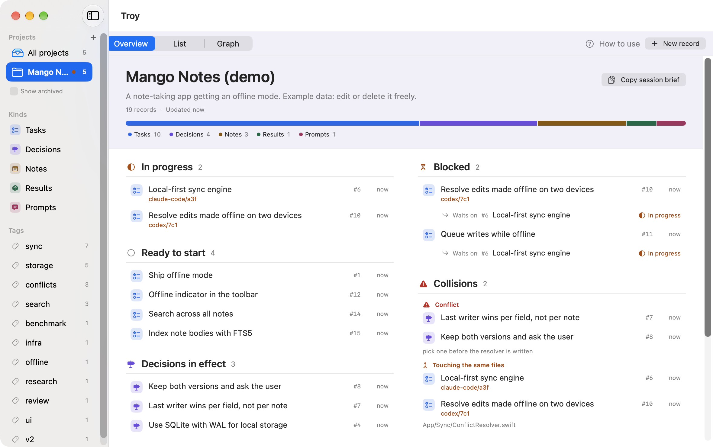
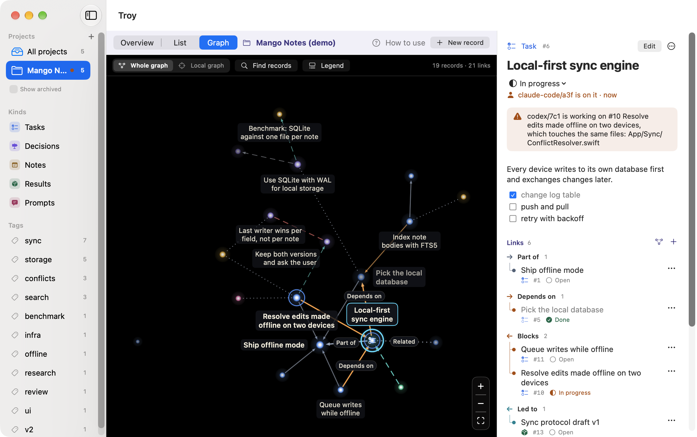
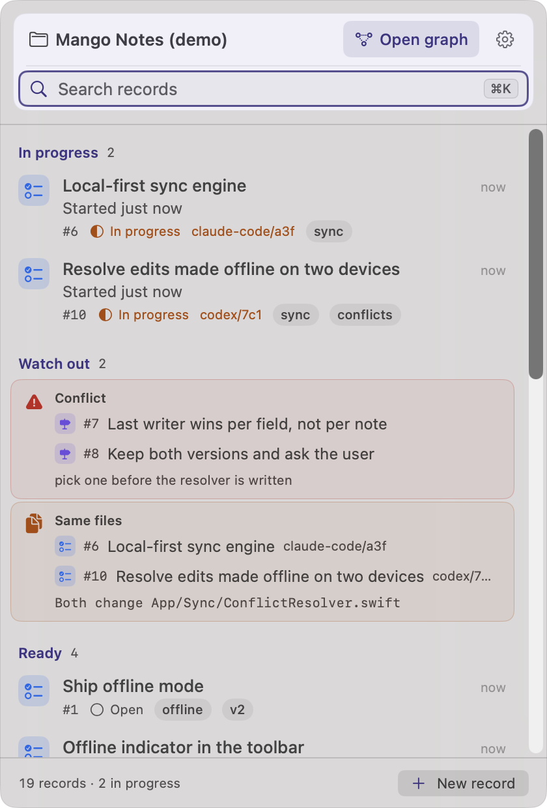
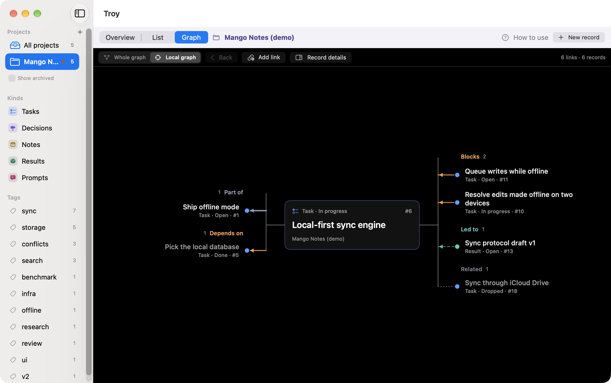

# Troy

**Project memory for AI coding agents, on your Mac.** Agents save tasks, decisions and findings through a local MCP server and link them into a graph. The next session, or another agent working in parallel, reads the state back instead of starting from nothing. A menu bar app shows you the same graph.

[한국어](README.ko.md)



- **Local.** One SQLite file in `~/Library/Application Support/Troy`. No account, no server, no network port.
- **Native.** A Swift menu bar app and a single `troy` binary. No Electron, no web view, no runtime to install, no third-party dependencies.
- **A graph, not a list.** A record can be part of several others, depend on some, replace one and conflict with another. Agents make those links when they save.
- **Built for more than one agent.** Starting a task claims it. Two sessions touching the same files, or saving a decision that contradicts an earlier one, are told about each other.
- **Cheap to read.** Record ids are small numbers, the project overview is titles only, and bodies are fetched on demand.

## How it works

```
Claude Code ──┐
Codex ────────┼── troy mcp (one process per client, stdio) ──┐
Cursor ───────┘                                              ├── troy.db (SQLite, WAL)
                                             Troy.app ───────┘
```

Every AI client starts its own `troy mcp` process. The app is one more process reading the same file, and it refreshes when anything changes. Agents keep working when the app is closed.

## Install

Requires macOS 14 or later and Swift 6.2 or later (Xcode 26). So far it has been built and run on macOS 27 only; reports from older systems are welcome.

```bash
git clone https://github.com/sjk0503/troy.git && cd troy
make install
```

This builds the app, signs it for your own machine, copies it to `/Applications/Troy.app` and links the command line tool to `~/.local/bin/troy`. Start Troy from Spotlight or `open -a Troy`; its icon appears in the menu bar.

To update an existing installation, quit Troy, run `git pull --ff-only && make install` from the cloned repository, then reopen Troy. Your projects and records stay on the Mac. Restart connected AI clients to load the updated MCP server.

There is no notarized download yet. An app you build yourself opens without a Gatekeeper prompt.

## Connect an AI client

Open **Settings → Connections** in the app and press Connect, or use the command line:

```bash
troy connect              # lists the clients found on this Mac and whether they are connected
troy connect claude-code  # registers Troy with Claude Code
```

To do it by hand, point the client at the `troy` binary with the argument `mcp`:

```bash
claude mcp add --transport stdio --scope user troy -- ~/.local/bin/troy mcp
```

```bash
codex mcp add troy -- ~/.local/bin/troy mcp
```

For Cursor (`~/.cursor/mcp.json`) and Claude Desktop (`claude_desktop_config.json`):

```json
{ "mcpServers": { "troy": { "command": "/Users/you/.local/bin/troy", "args": ["mcp"] } } }
```

**Claude Code: allow Troy's tools.** Claude Code asks before each call of a tool that no rule allows, and a session nobody watches (`claude -p`, a delegated worker) is refused instead of asked. Add this to `~/.claude/settings.json` (`troy connect claude-code` prints it too; Troy never changes your permissions itself):

```json
{ "permissions": { "allow": ["mcp__troy"] } }
```

After that there is nothing to tell the agent: the server's instructions say to read the project's state when work starts and to save decisions, findings and finished work as they happen, without being asked. In a folder without a project, `troy_context` tells the agent how to start, and the first record it saves creates the project, named after the folder and linked to it, so later sessions (and other worktrees of the same repository) find it on their own. That folder is the git repository, or, outside one, the work folder the session runs in when it lies at least two levels below your home folder (`~/dev/notes`, also in iCloud Drive or on another volume). The folders right in your home folder (`~/dev`, `~/Documents`) hold projects and never become one. Reading never creates anything. For a different name, or a folder Troy does not take for a project on its own, ask the agent to call `troy_new_project`.

## What an agent sees

`troy_context` at the start of a session:

```
Project #3 "Mango Notes" — /Users/you/dev/mango
19 records · 5 open tasks · 2 in progress · last activity 5m ago

IN PROGRESS
#6 Local-first sync engine — claude-code/a3f, 2h · part of #1 · paths: App/Sync
#10 Resolve edits made offline on two devices — codex/7c1, 40m · part of #1

READY
#12 Offline indicator in the toolbar · part of #1

BLOCKED
#11 Queue writes while offline — waits on #6

WATCH OUT
#8 conflicts with #7: pick one before the resolver is written
#6 and #10 are both in progress and touch App/Sync/ConflictResolver.swift

DECISIONS IN EFFECT
#4 Use SQLite with WAL for local storage (2026-11-24)
```

| Tool | What it does |
|---|---|
| `troy_context` | The state of the project: in progress, ready, blocked, collisions, decisions in effect, recent. |
| `troy_save` | Stores one record and its links. Replies with similar existing records and warnings. The first save in a folder creates its project. |
| `troy_update` | Changes a record. `status: "doing"` claims it; `append` adds to the body without resending it. |
| `troy_link` | Adds or removes a link between two records. |
| `troy_search` | Finds records containing every word, with a snippet each. |
| `troy_read` | Full records with their links. |
| `troy_projects`, `troy_new_project` | Lists projects; creates one linked to a folder, under a name you choose. |

The server tells agents to use these without being asked. A narrowly scoped prompt can still make an agent skip them (measured with Codex), so to put the same rule in a project's own instructions, paste the output of `troy guide` into its `AGENTS.md` or `CLAUDE.md`. Optionally add the session-start hook from `troy guide --hook`, which prints the project's state before the agent's first turn (in a folder without a project, how the first save creates one).

## The graph

Records are tasks, decisions, notes, results and prompts. Their status is open, doing, done or dropped.

| Link | Reads as | Use it when |
|---|---|---|
| `part_of` | part of / contains | a task is a sub-task of another |
| `depends_on` | depends on / blocks | one thing must be finished first |
| `derived_from` | derived from / led to | a decision came out of a finding |
| `supersedes` | supersedes / superseded by | a newer decision replaces an older one |
| `relates_to` | relates to | same topic |
| `conflicts_with` | conflicts with | two decisions contradict, or two tasks overlap |

A record can carry any number of links in any combination. Cycles in the directed relations are refused. Nothing is linked automatically: when an agent saves a record, Troy answers with the existing records that look similar, and the agent decides whether to link, reuse or keep them apart.

### Keeping agents out of each other's way

- **Claims.** Setting a task to `doing` records who took it. A second session that tries is told who holds it and since when, and has to say `takeover` to replace a session that is gone.
- **Path overlap.** A task can list the files it touches. When another session is working on overlapping files, both are told.
- **Dependencies and conflicts.** Starting a task that waits on unfinished work, or that conflicts with another open record, comes back with a warning.

These are warnings, never locks. A session that crashed cannot block anyone.

## The app

| The graph | The menu bar panel |
|---|---|
|  |  |

- **Menu bar panel**: what is in progress, what is ready, what collides, and search. Toggle it with ⌃⌥T.
- **Project overview** shows who owns each task, what can start now, what is blocked and which decisions still apply. Use **Copy session brief** to bring this context into a new AI session. The main window starts here on first launch and remembers the last view you used.
- **List** lets you filter by project, kind or tag. Select a record to open its text, links, advisories and history in the inspector.
- **Local graph** lets you follow a record to its prerequisites and the work that depends on it. Select a neighbor to make it the center of the map, including records in another project.
- **Editing**: create and edit records, add and remove links, manage projects and their folders. Every change an agent or you make keeps the previous version.
- **Settings**: connect AI clients, language (English and Korean), launch at login, backup, export.



## Command line

```
troy mcp                      run the MCP server (clients start this)
troy context                  print the project state for the current folder
troy search <words>           find records
troy read <id>...             print records with their links
troy projects                 list projects
troy new-project <name>       create a project linked to this folder
troy export [--out file]      everything as Markdown
troy backup <file>            a complete copy of the database in one file
troy stats [--days N]         how agents used Troy and what it cost
troy connect [client]         connect an AI client
troy guide [--hook]           text for AGENTS.md, or the session-start hook
troy demo                     add an example project
troy doctor                   where the database is and whether it is healthy
```

`--db <path>` or `TROY_DB` selects another database file.

## Your data

Everything is in one SQLite database: `~/Library/Application Support/Troy/troy.db`. Removing the app does not remove it.

```bash
troy backup ~/Documents/troy-backup.db
```

`troy backup`, or **Back Up…** in Settings → Data, writes a complete copy as a single file, also while agents are working. Don't copy `troy.db` by hand instead: SQLite keeps the most recent writes in `troy.db-wal` next to it, so the file alone can be missing them. Backups of the whole folder, Time Machine included, are fine. To restore, quit Troy and your AI clients, then put the backup in place of `troy.db` and delete `troy.db-wal` and `troy.db-shm`.

`troy export` writes every record and link as Markdown, for reading or for moving elsewhere.

### Usage log

Troy keeps a small log of how agents use it, so you can judge whether it earns its place. It sits next to the database (`troy.db` → `troy-usage.db`), never leaves your Mac, and holds no content: only tool names, sizes, timings, counts, record numbers and project numbers. Titles, bodies, search words and folder paths are never logged. Rows older than 90 days are removed. Set `TROY_USAGE=off` to turn the log off.

`troy stats` summarizes the last 7 days (`--days N`; `--json` for the numbers and a per-day series): server starts per client, hook runs, calls and errors per tool, the text each tool returned, the estimated context cost, and how often claims, advisories and records written by another agent came up. Token counts are estimated from text size; exact numbers are in each client's own session logs. Hook runs are matched to servers by the client process that started them, which works when the client starts both directly, as `troy guide --hook` sets it up; a hook wrapped in a script is counted but not matched.

## Development

```bash
swift build
swift test
make app      # build/Troy.app
```

A screen can be checked without clicking through the app: `TroyApp --render main --out main.png --demo en` draws it off screen, and `python3 Scripts/screenshots.py` regenerates the images on this page from real windows.

[docs/ARCHITECTURE.md](docs/ARCHITECTURE.md) describes the parts and the rules. [CONTRIBUTING.md](CONTRIBUTING.md) covers the workflow.

## License

MIT. See [LICENSE](LICENSE).
